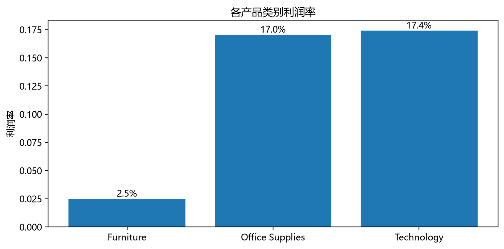
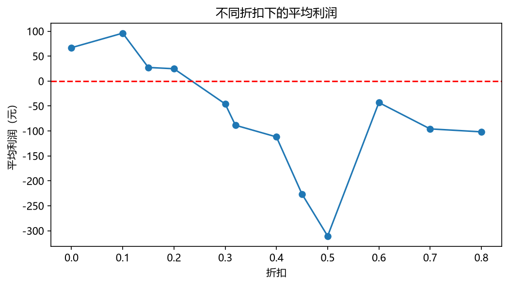
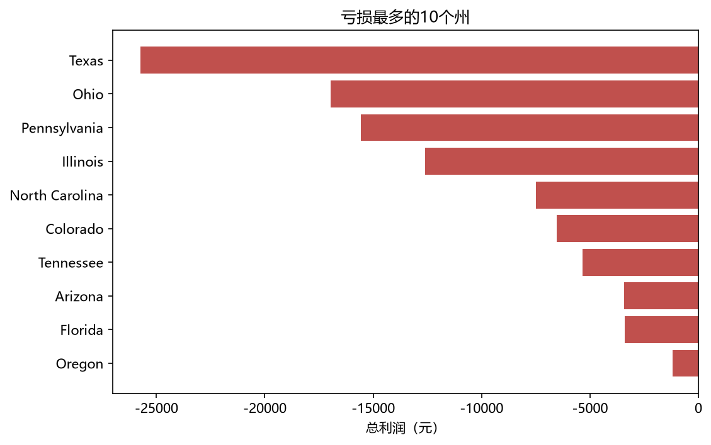

# 超市销售数据分析（Superstore）

基于 Superstore 公开数据集（2014-2017）的销售与利润分析，使用 Python 完成数据清洗、探索与可视化。

数据来源：[Kaggle Superstore Dataset](https://www.kaggle.com/datasets/vivek468/superstore-dataset-final)

## 1. 背景
基于 Superstore 公开数据集（2014-2017，9,993 条订单明细）分析整体盈利情况，定位低利润品类、地区与折扣问题，为定价和促销策略提供依据。

## 2. 核心指标
- 总销售额：约 229.7 万
- 总利润：约 28.64 万
- 整体利润率：12.47%
- 订单数：5,009；客户数：793

## 3. 主要发现
1. 品类分化明显：Furniture 销售额 74.2 万但利润率仅 2.49%；Technology 17.40%、Office Supplies 17.04%，Furniture 拖累整体。
2. 亏损集中在子类别：Tables 亏 1.77 万（-8.56%）、Bookcases 亏 3,473（-3.02%）、Supplies 亏 1,189（-2.55%）。
3. 折扣侵蚀利润：整体约在 8 折接近盈亏线，7 折以下转亏；5 折档平均每单亏约 310 元。
4. 亏损集中于少数州：Texas 亏 2.57 万（-15.1%）、Ohio 亏 1.70 万（-21.7%）、Pennsylvania 亏 1.56 万、Illinois 亏 1.26 万；Top10 州合计亏损约 9.8 万。
5. 极端折扣是主因：4 折及以下订单中 Binders 亏 3.85 万（613 单），Machines 仅 23 单却亏 1.96 万（单均 -851 元）；Texas 的 Binders（153 单）和 Appliances（47 单）全部为 2 折。

## 4. 建议
1. 设置品类差异化折扣上限：Tables、Bookcases 折扣不超过 8 折，超出需审批。
2. 重点复核 Texas、Ohio、Illinois 的 Binders、Appliances 2 折促销。
3. 高单价产品（Tables、Machines、Bookcases）的深折扣单独审批。
4. 建立月度折扣-利润监控看板，对利润率低于阈值的品类和州告警。

## 5. 局限
- 公开历史数据，不代表当前业务；
- 折扣与亏损为强相关，未控制竞争、成本等外部因素；
- 原始数据存在编码与引号格式问题，已修复并去除 1 条重复记录。

## 6. 工具
Python（pandas、matplotlib）、SQL（SQLite）、Tableau、Jupyter Notebook

## 7. SQL 分析

使用 SQLite 数据库完成 SQL 部分分析，完整查询与结果见 [sql_analysis.md](sql_analysis.md)。

- Furniture 利润显著低于其他品类；
- Texas、Ohio、Pennsylvania、Illinois 为亏损主要州；
- 折扣超过 20% 后平均利润转负，5 折亏损最深，主要来自 Tables、Machines、Bookcases 等高单价品类。

SQL 结果与 pandas 结果一致，已完成交叉验证。

## 8. Tableau 看板

交互式看板已发布到 Tableau Public：[Superstore 销售利润分析看板](https://public.tableau.com/app/profile/.17934702/viz/SuperstoreSalesProfitAnalysis_17954380824070/Superstore)
